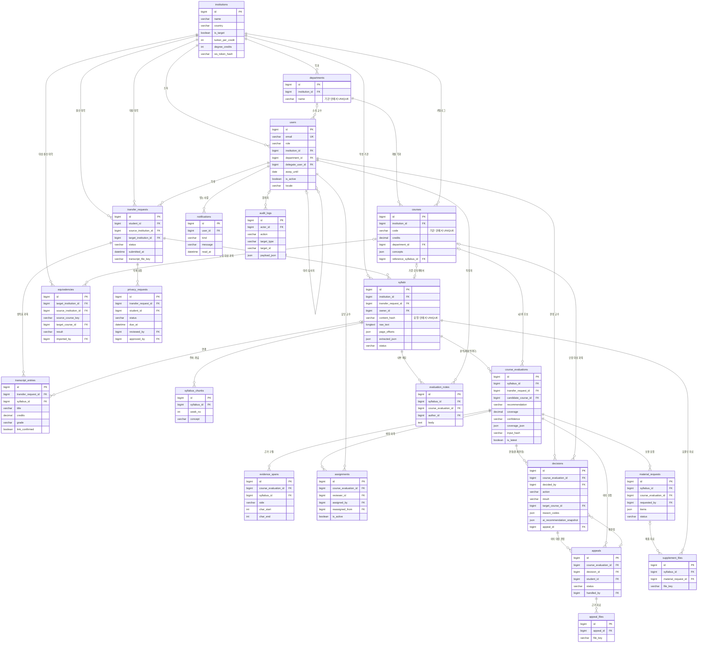

# CreditBridge AI ERD (데이터베이스 구조)

[API 명세서](API_Spec.md)가 읽고 쓰는 데이터를 [기획 통합본](spec.md) 4장 기능 명세(FR-01~FR-27)에 맞춰 엔티티·속성·관계로 정리했다. 마지막 절에 구조 검토 결과가 있다.

- 기준: 2026-10-19 main, Alembic 0001~0011. 실제 정의는 `backend/models/`(테이블당 1파일), 변경은 `alembic/versions/`로만.
- DB: MariaDB 11.8, MySQL 8.0 호환 문법, utf8mb4. 시간은 모두 UTC `DATETIME(6)`. 기본키는 `id BIGINT UNSIGNED AUTO_INCREMENT`.
- 원본 파일(강의계획서·성적표·보완 자료·이의 근거 자료)은 DB가 아니라 객체 스토리지(S3)에 두고 DB에는 파일 키만 저장한다.

## 1. 엔티티 한눈에 보기 (22개)

| 영역 | 엔티티 | 한 줄 설명 | 주요 FR |
| --- | --- | --- | --- |
| 기관·사용자 | `institutions` | 출신 대학과 대상(편입) 대학 | FR-12·15·24 |
| | `departments` | 대상 대학의 학과 (과목·교수 배정 기준) | FR-05·18 |
| | `users` | 학생·심사관·교수·관리자 계정 | FR-12·19 |
| | `courses` | 대상 대학 카탈로그 과목과 필수 개념 | FR-05 |
| 편입 요청·문서 | `transfer_requests` | 학생의 편입 학점 심사 요청 묶음 | FR-15·21 |
| | `syllabi` | 강의계획서(학생 업로드·대상 과목 기준)와 추출 결과 | FR-01·03·04·14·25 |
| | `syllabus_chunks` | 주차·개념 단위로 나눈 강의계획서 글 | FR-03 |
| | `transcript_entries` | 성적표에서 뽑은 과목과 강의계획서 연결 | FR-02 |
| AI 분석 | `course_evaluations` | 강의계획서 한 건의 AI 분석 결과(재분석마다 새 행) | FR-05~08·16 |
| | `evidence_spans` | 원문 검증을 통과한 근거 구절 위치 | FR-06·25 |
| 심사 | `assignments` | 교수 배정·대리 재배정 이력 | FR-18·19 |
| | `decisions` | 교수 최종 판정 (추가 전용) | FR-09·10·11 |
| | `material_requests` | 보완 자료 요청 | FR-22 |
| | `supplement_files` | 학생이 낸 보완 자료 원본 | FR-22 |
| | `appeals` | 이의 신청 | FR-23 |
| | `appeal_files` | 이의 신청 근거 자료 원본 | FR-23 |
| | `evaluation_notes` | 심사 건 내부 메모 (교직원만) | – |
| | `equivalencies` | 기관이 가져온 기존 동등 과목표 | FR-11·26 |
| 개인정보·운영 | `privacy_requests` | 문서 삭제 요청과 처리 단계 | FR-13 |
| | `notifications` | 화면 알림과 알림 메일 | FR-19·20 |
| | `audit_logs` | 주요 행위 기록 (추가 전용) | FR-10 |

## 2. ER 다이어그램

키와 관계를 보이는 속성만 넣었다. 전체 속성은 3절.

## 3. 엔티티와 속성

표기: `PK` 기본키 · `FK→테이블` 외래키 · `UQ` 유일 · `IX` 인덱스 · `NN` NOT NULL · `null` 비어도 됨. 모든 테이블에 `id BIGINT UNSIGNED PK`가 있고, 따로 적지 않으면 `created_at DATETIME(6) NN`(만든 시각)도 있다.

### 3.1 기관·사용자

**institutions** — 출신 대학(학생이 다니던 곳)과 대상 대학(CreditBridge를 쓰는 편입 대학)을 한 테이블에 두고 `is_target`으로 나눈다.

| 속성 | 타입 | 제약 | 설명 |
| --- | --- | --- | --- |
| name | VARCHAR(200) | NN | 대학 이름 (동등 과목표 CSV의 출신 대학 이름과 똑같아야 함) |
| country | VARCHAR(2) | NN | 국가 코드 (KR, US) |
| is_target | BOOLEAN | NN | 대상 대학 여부 |
| tuition_per_credit | INT | null | 학점당 등록금 (FR-15 시뮬레이션 기본값) |
| degree_credits | INT | null | 졸업 학점 (FR-15) |
| sis_token_hash | VARCHAR(64) | null | 학사정보시스템 연동 토큰의 해시 (원문은 저장하지 않음, FR-24) |

**departments** — 대상 대학의 학과. `(institution_id, name)` UNIQUE. 과목 CSV를 가져올 때 새 학과명이면 만들고, 계정 CSV·관리자 계정 수정은 과목이 있는 학과만 고른다. 학과명을 고치면 과목·교수가 함께 따라간다(Alembic 0011).

| 속성 | 타입 | 제약 | 설명 |
| --- | --- | --- | --- |
| institution_id | BIGINT | FK→institutions, NN | 기관 |
| name | VARCHAR(50) | NN, UQ(기관 안) | 학과명 (예: Mathematics) |

**users** — 역할 하나와 소속 기관 하나를 가진다. 지우지 않고 비활성화한다(판정·감사 기록이 가리키므로).

| 속성 | 타입 | 제약 | 설명 |
| --- | --- | --- | --- |
| email | VARCHAR(255) | NN, UQ | 로그인 이메일 |
| password_hash | VARCHAR(255) | NN | Argon2 해시 |
| name | VARCHAR(100) | NN | 이름 |
| role | VARCHAR(20) | NN, IX | student · evaluator · professor · admin (FR-12) |
| institution_id | BIGINT | FK→institutions, null | 소속 기관 |
| department_id | BIGINT | FK→departments, IX, null | 교수의 학과 (과목과 같은 학과 행이어야 자동 배정, FR-18). 심사관은 선택, 학생·관리자는 비움 |
| delegate_user_id | BIGINT | FK→users, null | 부재 시 대리 심사자 (FR-19) |
| away_until | DATE | null | 부재 종료일 (FR-19) |
| must_change_password | BOOLEAN | NN | 임시 비밀번호 → 첫 로그인 때 변경 |
| failed_logins | INT | NN | 연속 로그인 실패 수 (5회 1분 잠금, 10회 초기화) |
| locked_until | DATETIME | null | 로그인 잠금 해제 시각 |
| is_active | BOOLEAN | NN | 비활성화 여부 |
| deactivated_at | DATETIME | null | 비활성화 시각 |
| locale | VARCHAR(5) | null | 화면·알림·메일 언어 ko·en |

**courses** — 대상 대학 카탈로그. 기준 강의계획서가 있어야 AI 비교 후보가 된다.

| 속성 | 타입 | 제약 | 설명 |
| --- | --- | --- | --- |
| institution_id | BIGINT | FK→institutions, NN, IX | 대상 대학 |
| code | VARCHAR(30) | NN, UQ(institution_id, code) | 과목 코드 (MATH 1151) |
| title | VARCHAR(200) | NN | 과목명 |
| credits | DECIMAL(4,1) | NN | 학점 |
| department_id | BIGINT | FK→departments, NN, IX | 학과 (후보 선정 필터·교수 배정 기준, FR-05·18) |
| level | TEXT | NN | 과목 수준 설명 (FR-16) |
| concepts | JSON | null | 학과가 정한 필수 개념 목록 (FR-05) |
| reference_syllabus_id | BIGINT | FK→syllabi, null | 기준 강의계획서 |

### 3.2 편입 요청·문서

**transfer_requests** — 학생 한 명이 대상 대학 한 곳에 내는 요청 묶음.

| 속성 | 타입 | 제약 | 설명 |
| --- | --- | --- | --- |
| student_id | BIGINT | FK→users, NN, IX | 학생 |
| source_institution_id | BIGINT | FK→institutions, NN | 출신 대학 |
| target_institution_id | BIGINT | FK→institutions, NN, IX | 대상 대학 |
| major | VARCHAR(100) | NN | 편입 전공 |
| status | VARCHAR(20) | NN, IX | draft(사전 시뮬레이션) · submitted · decided (FR-21) |
| submitted_at | DATETIME | null | 학사처에 심사 요청한 시각 |
| transcript_file_key | VARCHAR(255) | null | 성적표 원본 파일 키 (삭제 승인 후 null) |
| transcript_masked_name | VARCHAR(100) | null | 가린 이름 `L** J****` (FR-13) |

**syllabi** — 학생이 올린 강의계획서와, 대상 과목의 기준 강의계획서를 함께 담는다(기준은 `transfer_request_id`가 null).

| 속성 | 타입 | 제약 | 설명 |
| --- | --- | --- | --- |
| institution_id | BIGINT | FK→institutions, NN, IX | 학생 것은 대상 대학, 기준 것은 그 과목의 대학 |
| transfer_request_id | BIGINT | FK→transfer_requests, IX, null | 속한 요청 (기준 강의계획서는 null) |
| owner_id | BIGINT | FK→users, null | 올린 학생 |
| source_file_key | VARCHAR(255) | null | 원본 파일 키 (삭제 승인 후 null) |
| content_hash | VARCHAR(64) | NN, IX, UQ(transfer_request_id, content_hash) | 원본 SHA-256. 같으면 LLM을 다시 부르지 않고 결과 재사용 |
| original_filename | VARCHAR(255) | NN | 올린 파일 이름 |
| language | VARCHAR(8) | NN | 문서 언어 |
| raw_text | LONGTEXT | NN | 추출 글자 (보완 자료는 `[보완 자료: 이름]` 표시 뒤에 덧붙임) |
| page_offsets | JSON | null | 원본 PDF 쪽별 글자 위치 (FR-25) |
| course_code · course_title · credits | VARCHAR(50) · VARCHAR(255) · DECIMAL(4,1) | NN·NN·null | 추출한 과목 정보 (검색용으로 JSON 밖에 둠) |
| extracted_json | JSON | CHECK JSON_VALID, null | 6개 필드 구조화 결과 (FR-03·04) |
| extraction_model | VARCHAR(100) | null | 추출에 쓴 모델 |
| quality_score | DECIMAL(4,3) | null | 인식 품질 0~1 (FR-01) |
| injection_flags | JSON | null | 판정 유도 의심 문구 줄 (FR-14) |
| status | VARCHAR(20) | NN | uploaded · processing · ready · failed · deleted |
| error_message | VARCHAR(500) | null | 실패 사유 (한국어 원문, 화면에서 번역) |

**syllabus_chunks** — `syllabus_id` FK→syllabi(ON DELETE CASCADE, IX), `week_no` INT null, `concept` VARCHAR(255), `text` TEXT, `char_start`·`char_end` INT null(원문 위치). `created_at` 없음.

**transcript_entries** — `transfer_request_id` FK(IX), `title` VARCHAR(255), `code` VARCHAR(50) null, `credits` DECIMAL(4,1) null, `grade` VARCHAR(10) null, `term` VARCHAR(50) null, `syllabus_id` FK→syllabi null(연결된 강의계획서), `link_score` DECIMAL(4,3) null(자동 연결 점수), `link_confirmed` BOOLEAN(학생 확인). 성적은 이 테이블에만 있고 로그·알림에는 쓰지 않는다.

### 3.3 AI 분석

**course_evaluations** — 고치지 않고 재분석마다 새 행을 만든다. 최신 행만 `is_latest`.

| 속성 | 타입 | 제약 | 설명 |
| --- | --- | --- | --- |
| syllabus_id | BIGINT | FK→syllabi, NN, IX | 분석한 강의계획서 |
| transfer_request_id | BIGINT | FK→transfer_requests, IX, null | 속한 요청 (권한 검사용으로 함께 둠) |
| candidate_course_id | BIGINT | FK→courses, IX, null | 1순위 후보 (억지 매핑 안 하면 null, FR-05) |
| status | VARCHAR(20) | NN, IX | queued · running · done · failed |
| recommendation | VARCHAR(20) | IX, null | direct · elective · none · insufficient (FR-07·08) |
| coverage | DECIMAL(4,3) | null | 1순위 개념 커버리지 0~1 |
| confidence | VARCHAR(10) | IX, null | high · medium · low |
| level_flag | VARCHAR(10) | null | same · lower · higher (FR-16) |
| coverage_json | JSON | null | 후보 3개·개념별 판단·근거·정보 부족 진단·경고, 한국어·영어 설명 |
| summary | TEXT | NN | 요약 (한국어) |
| input_hash | VARCHAR(64) | IX, null | 프롬프트 버전·규칙 버전·모델·입력의 해시 (같으면 결과 재사용) |
| prompt_version · model | VARCHAR(20) · VARCHAR(100) | null | evaluation-v2 등 |
| error_message | VARCHAR(500) | null | 실패 사유 |
| is_latest | BOOLEAN | NN, IX | 그 강의계획서의 최신 분석 (`syllabus_id, is_latest` 복합 IX) |
| latest_syllabus_id | BIGINT 생성 컬럼(STORED) | UQ | `IF(is_latest, syllabus_id, NULL)` — 강의계획서당 최신 분석 하나 (0010) |

판정 확률(%) 컬럼은 두지 않는다 (MVP 규칙).

**evidence_spans** — `course_evaluation_id` FK(IX), `side` VARCHAR(10)(source·target), `syllabus_id` FK→syllabi, `char_start`·`char_end` INT, `concept` VARCHAR(255), `verified` BOOLEAN. 원문 문자열과 일치한 구절만 저장한다(FR-06). `created_at` 없음.

### 3.4 심사

**assignments** — 배정이 바뀌면 이전 행을 `is_active=false`로 두고 새 행을 만든다(이력 보존).

| 속성 | 타입 | 제약 | 설명 |
| --- | --- | --- | --- |
| course_evaluation_id | BIGINT | FK, NN, IX | 심사 건 |
| reviewer_id | BIGINT | FK→users, NN, IX | 담당 교수 |
| assigned_by | BIGINT | FK→users, null | 배정한 심사관 (자동 이어 붙이기는 null) |
| assigned_at | DATETIME(6) | NN | 배정 시각 (판정 기한 계산 기준) |
| reassigned_from | BIGINT | FK→users, null | 대리 재배정이면 원래 교수 (FR-19) |
| is_active | BOOLEAN | NN | 현재 배정 (`course_evaluation_id, is_active`·`reviewer_id, is_active` 복합 IX) |
| active_evaluation_id | BIGINT 생성 컬럼(STORED) | UQ | `IF(is_active, course_evaluation_id, NULL)` — 심사 건당 활성 배정 하나 (0010) |

**decisions** — 추가 전용(INSERT만). 이의 신청 재판정도 새 행. 현재 판정은 그 심사 건의 가장 늦은 `decided_at`.

| 속성 | 타입 | 제약 | 설명 |
| --- | --- | --- | --- |
| course_evaluation_id | BIGINT | FK, NN, IX | 심사 건 |
| decided_by | BIGINT | FK→users, NN | 판정한 교수 (사람 id 필수, FR-09) |
| action | VARCHAR(10) | NN | approve · modify · reject |
| result | VARCHAR(10) | NN | direct · elective · none |
| target_course_id | BIGINT | FK→courses, null | 직접 인정 대상 과목 |
| reason_codes | JSON | NN | 선택형 사유 코드 목록 |
| reason_memo | TEXT | NN | 소명 메모 ('기타'면 필수) |
| ai_recommendation_snapshot | JSON | NN | 판정 당시 AI 추천·커버리지·신뢰도·프롬프트 버전 (FR-10) |
| conflict_acknowledged | BOOLEAN | NN | 과거 판정과 다른 결과임을 확인했는지 (FR-11) |
| appeal_id | BIGINT | FK→appeals, null | 재판정이면 그 이의 신청 |
| decided_at | DATETIME(6) | NN | 판정 시각 (`created_at` 대신) |

**material_requests** — `syllabus_id` FK(IX), `course_evaluation_id` FK, `requested_by` FK→users, `items` JSON(요청 항목, 한국어 원문), `note` TEXT, `status` VARCHAR(20)(open·fulfilled, IX), `fulfilled_at` DATETIME null.

**supplement_files** — `syllabus_id` FK(IX), `file_key` VARCHAR(255) null(삭제 후 null), `material_request_id` FK null(요청 없이 낸 사전 시뮬레이션 자료는 null).

**appeals**

| 속성 | 타입 | 제약 | 설명 |
| --- | --- | --- | --- |
| course_evaluation_id | BIGINT | FK, NN, IX | 심사 건 |
| decision_id | BIGINT | FK→decisions, NN | 이의를 건 판정 |
| student_id | BIGINT | FK→users, NN, IX | 신청한 학생 |
| reason | TEXT | NN | 사유 20~3000자 |
| status | VARCHAR(20) | NN, IX | submitted · accepted · dismissed · redecided |
| handled_by · handled_at · handler_note | BIGINT FK · DATETIME · TEXT | null·null·NN | 처리한 심사관·시각·메모 (기각 시 필수) |
| open_evaluation_id | BIGINT 생성 컬럼(STORED) | UQ | 접수·수용 상태일 때만 `course_evaluation_id` — 심사 건당 처리 중 이의 신청 하나 (0010) |

**appeal_files** — `appeal_id` FK(IX), `file_key` VARCHAR(255) null, `original_filename` VARCHAR(255), `content_type` VARCHAR(100), `size` INT.

**evaluation_notes** — `syllabus_id` FK(IX, 재분석해도 이어지게 강의계획서 단위), `course_evaluation_id` FK(쓴 분석 회차), `author_id` FK→users, `body` TEXT(1000자). 고치지 않고 새로 남기며 삭제 승인 때만 지운다.

**equivalencies** — `target_institution_id` FK(`target_institution_id, source_institution_id, source_course_key` 복합 IX), `source_institution_id` FK, `source_course_key` VARCHAR(100)(IX, 비교용 정규화 키), `source_course_label` VARCHAR(255), `target_course_id` FK→courses null, `result` VARCHAR(10), `decided_on` DATE null, `note` TEXT(기관 내부 메모, 학생에게 안 보임), `imported_by` FK→users.

### 3.5 개인정보·운영

**privacy_requests** — `transfer_request_id` FK(IX), `student_id` FK→users, `status` VARCHAR(20)(requested·reviewed·completed, IX), `due_at` DATETIME(처리 기한), `reviewed_by`·`reviewed_at`(심사관 처리), `approved_by`·`completed_at`(관리자 승인·삭제 완료), `open_request_id`(생성 컬럼, 완료 전이면 `transfer_request_id`, UQ — 요청당 처리 중 삭제 요청 하나, 0010).

**notifications** — `user_id` FK(`user_id, read_at` 복합 IX), `kind` VARCHAR(30)(assignment.created 등), `message` VARCHAR(500)(한국어 원문, 화면·메일에서 받는 사람 언어로), `link` VARCHAR(255), `read_at` null, `emailed_at` null.

**audit_logs** — 추가 전용(INSERT만). `actor_id` FK→users null(시스템 행위는 null, `actor_id, action` 복합 IX), `action` VARCHAR(50)(IX), `target_type` VARCHAR(50)·`target_id` VARCHAR(36)(대상, 외래키 없음, `target_type, target_id` 복합 IX), `payload_json` JSON(id·판정값만, 이름·학번·성적 없음).

## 4. 관계

| # | 관계 | 카디널리티 | 외래키 | 근거 (기능 명세) |
| --- | --- | --- | --- | --- |
| 1 | 기관 – 사용자 | 1 : N (사용자 쪽 0..1) | users.institution_id | FR-12 소속 기관 건만 접근 |
| 2 | 사용자 – 대리 심사자 (자기 참조) | 0..1 : N | users.delegate_user_id | FR-19 |
| 3 | 대상 대학 – 과목 | 1 : N | courses.institution_id | FR-05 카탈로그 |
| 3a | 대상 대학 – 학과 | 1 : N | departments.institution_id | FR-18 |
| 3b | 학과 – 과목 | 1 : N | courses.department_id | FR-05 후보 필터 |
| 3c | 학과 – 교수 | 0..1 : N | users.department_id | FR-18 자동 배정, FR-19 같은 학과 대리 |
| 4 | 과목 – 기준 강의계획서 | 0..1 : 0..1 | courses.reference_syllabus_id | FR-05 개념 비교 기준 |
| 5 | 학생 – 편입 요청 | 1 : N | transfer_requests.student_id | FR-15 |
| 6 | 출신·대상 대학 – 편입 요청 | 1 : N (두 번) | source_institution_id, target_institution_id | FR-15 |
| 7 | 편입 요청 – 강의계획서 | 1 : N (요청당 최대 30) | syllabi.transfer_request_id | FR-01 |
| 8 | 편입 요청 – 성적표 과목 | 1 : N | transcript_entries.transfer_request_id | FR-02 |
| 9 | 성적표 과목 – 강의계획서 | N : 0..1 | transcript_entries.syllabus_id | FR-02 자동 연결·학생 확인 |
| 10 | 강의계획서 – 청크 | 1 : N (함께 삭제) | syllabus_chunks.syllabus_id | FR-03 |
| 11 | 강의계획서 – 분석 | 1 : N (최신 1개 is_latest) | course_evaluations.syllabus_id | FR-05 재분석 이력, FR-22 |
| 12 | 과목 – 분석 (1순위 후보) | 0..1 : N | course_evaluations.candidate_course_id | FR-05 |
| 13 | 분석 – 근거 구절 | 1 : N | evidence_spans.course_evaluation_id | FR-06 |
| 14 | 분석 – 배정 | 1 : N (활성 1개) | assignments.course_evaluation_id | FR-18 |
| 15 | 교수 – 배정 | 1 : N | assignments.reviewer_id, reassigned_from | FR-18·19 |
| 16 | 분석 – 판정 | 1 : N (원 판정 + 재판정) | decisions.course_evaluation_id | FR-09·10 |
| 17 | 교수 – 판정 | 1 : N | decisions.decided_by | FR-09 사람만 확정 |
| 18 | 판정 – 이의 신청 | 1 : N (처리 중 1개) | appeals.decision_id | FR-23 |
| 19 | 이의 신청 – 재판정 | 0..1 : N | decisions.appeal_id | FR-23 재판정도 새 행 |
| 20 | 이의 신청 – 근거 자료 | 1 : N (최대 3) | appeal_files.appeal_id | FR-23 |
| 21 | 분석 – 보완 요청 | 1 : N | material_requests.course_evaluation_id (+ syllabus_id) | FR-22 |
| 22 | 보완 요청 – 보완 자료 | 0..1 : N | supplement_files.material_request_id | FR-22 |
| 23 | 강의계획서 – 내부 메모 | 1 : N | evaluation_notes.syllabus_id | 운영 |
| 24 | 편입 요청 – 삭제 요청 | 1 : N (처리 중 1개) | privacy_requests.transfer_request_id | FR-13 |
| 25 | 사용자 – 알림 | 1 : N | notifications.user_id | FR-19·20 |
| 26 | 사용자 – 감사 로그 | 0..1 : N | audit_logs.actor_id | FR-10 |
| 27 | 대상·출신 대학, 과목 – 동등 과목표 | 1 : N | equivalencies.* | FR-11·26 |

### 4.1 API가 쓰는 데이터 (API_Spec.md 연결)

| 엔티티 | 만드는 API | 바꾸는 API | 읽는 화면(조회 API) |
| --- | --- | --- | --- |
| institutions | M8, 첫 관리자 스크립트 | M12(토큰) | S1·S15·M11 |
| users | M5, 첫 관리자 스크립트 | A3(실패 수·언어), A5, A7, A11, F2, M6, M7, M16(이름·department_id·대리 심사자) | 대부분 (권한·이름) |
| departments | M3(새 학과명), M5 | – | M2·M14·M15·R1·M1(학과별 지표) |
| courses | M3 | M3, M4 | R1·S10·R4·F3·M2 |
| transfer_requests | S2 | S5, S7, S8, 판정 완료 시 | S1·S3·R1 |
| syllabi | S4, M4 | S11, 작업 큐(추출·분석), M10(삭제) | S3·S10·R4·F3·C3 |
| transcript_entries | S5(작업 큐) | S6 | S3 |
| course_evaluations · evidence_spans | 작업 큐(분석) | 재분석 시 is_latest | S3·S10·R1·R4·F1·F3·C1·J1 |
| assignments | R2, R7(재판정), F2(대리), M7(비활성화 인계) | 같은 API | R1·F1·F3 |
| decisions | F4, J2 | – (추가 전용) | S3·S10·R4·F3·C1·M1·J1·J3·R3 |
| appeals · appeal_files | S13 | R7 | S14·R6·S10·C5 |
| material_requests · supplement_files | R5, F5 · S11 | S11 | S3·S10·R4·F3 |
| evaluation_notes | C4 | – | R4·F3 |
| equivalencies | R11 | – | R10·S15·R4·F3(과거 이력) |
| privacy_requests | S8 | R9, M10 | S3·R8·M9·M1 |
| notifications | 여러 처리 API, 기한 알림 작업 | A12·S10·S14(읽음) | A12·A13 |
| audit_logs | 거의 모든 처리 API, C3·C5 열람 | – (추가 전용) | M13(조건별·50건씩)·M1·C1·R4 |

## 5. 설계 규칙

| 규칙 | 적용 |
| --- | --- |
| 추가 전용 | `decisions`, `audit_logs`는 INSERT만. 앱 DB 계정에 UPDATE·DELETE 권한을 주지 않는다 (`docs/db-grants.sql`). 판정을 바꾸면 새 행 |
| 이력 보존 | `course_evaluations`(재분석), `assignments`(재배정), `evaluation_notes`는 고치지 않고 새 행 |
| 지우지 않는 삭제 | 개인정보 삭제는 파일 키를 null로, 글을 비우고 상태를 deleted로. 판정·감사 기록이 가리키는 행은 남긴다. 계정은 비활성화 |
| DB 검사 (0009) | 상태·코드 컬럼은 허용 목록 CHECK(`ck_<테이블>_<컬럼>_valid`), 0~1 점수·근거 위치·학점·파일 크기는 범위 CHECK. 허용 목록은 `backend/models/enums.py`와 같고, 값을 늘리면 모델과 새 마이그레이션을 함께 고친다 |
| JSON 사용 | MariaDB는 JSON 컬럼마다 `JSON_VALID` CHECK를 자동으로 붙이고 MySQL 8.0은 JSON 형식이 검사한다. 구조 검증은 Pydantic, 검색 조건에 쓰는 값은 JSON 밖 일반 컬럼으로 (`course_code`, `recommendation`, `coverage` 등) |
| 결과 재사용 | `syllabi.content_hash`(같은 문서), `course_evaluations.input_hash`(같은 비교 입력)로 LLM 재호출을 막는다 |
| 개인정보 | 이름은 `users.name`, 성적은 `transcript_entries`에만. 알림·감사 로그·AI 입력에는 넣지 않는다 (성적표는 가린 뒤 AI에) |
| 다국어 | 저장하는 안내 글은 한국어 원문, 화면에서 번역. AI 설명은 `coverage_json`에 한국어·영어(`*_en`) 두 벌 |

## 6. 검토 결과

### 6.1 저장되는 데이터 구조 (엔티티·속성)

| 점검 | 결과 |
| --- | --- |
| 기능 명세의 데이터가 모두 저장되는가 | ✅ FR-01~FR-27의 입력·출력이 모두 엔티티에 있다 (1절 주요 FR). FR-27 통계, FR-17 큐, FR-11 유사도는 저장하지 않고 조회할 때 계산. FR-28(복수 대학 비교)은 범위 밖이라 없음 |
| API가 쓰는 데이터가 모두 엔티티에 있는가 | ✅ 4.1절. 엔티티 21개 모두 만드는 API와 읽는 화면이 있다 |
| 판정 확률 컬럼이 없는가 | ✅ 없음 (MVP 규칙) |
| 원본 파일을 DB에 넣지 않는가 | ✅ 파일 키만 |

고칠 만한 점:

| # | 항목 | 내용 | 권장 |
| --- | --- | --- | --- |
| E1 | 학과가 글자 ✅ 반영 (0011) | `users.department`와 `courses.department`가 자유 글자다. 철자가 다르면 자동 배정이 안 된다 (화면이 "교수 없는 학과"로 경고만 함). 기능 명세 권한표의 "학과 설정"을 담을 곳도 없다 | `departments`(institution_id, name, UQ) 엔티티를 만들고 두 컬럼을 `department_id` FK로. (2026-10-19 반영: Alembic 0011이 기존 글자 값으로 학과 행을 만들고 id로 옮긴 뒤 글자 컬럼을 지웠다. 학생의 편입 전공 `transfer_requests.major`는 요청 당시 이름을 남기는 기록이라 글자로 둔다) |
| E2 | JSON 유효성 검사 ✅ 문제 아님 (확인) | `syllabi.extracted_json`에만 `JSON_VALID` CHECK가 있다. MariaDB의 JSON은 LONGTEXT라 나머지 JSON 컬럼(`courses.concepts`, `decisions.reason_codes`·`ai_recommendation_snapshot`, `course_evaluations.coverage_json`, `material_requests.items`, `audit_logs.payload_json`, `syllabi.page_offsets`·`injection_flags`)에는 잘못된 값이 들어갈 수 있다 (DB 규칙 위반) | 다시 확인해 보니 MariaDB가 `JSON`으로 만든 컬럼마다 `CHECK (json_valid(col))`를 자동으로 붙인다(`SHOW CREATE TABLE`로 확인). MySQL 8.0은 JSON 형식 자체가 검사한다. 추가할 것 없음 |
| E3 | 상태·코드 값 검사 ✅ 반영 (0009) | `role`, `status`, `recommendation`, `result`, `action`, `side` 등이 VARCHAR이고 허용 값 검사가 앱에만 있다 | `CHECK (status IN (...))` 추가 (MySQL 8.0.16+, MariaDB 지원) |
| E4 | 값 범위 검사 ✅ 반영 (0009) | `coverage`·`quality_score`·`link_score`(0~1), `evidence_spans.char_start < char_end`가 DB에서 검사되지 않는다 | CHECK 추가 |
| E5 | 사유 코드가 JSON 배열 | `decisions.reason_codes`라 "사유별 반려 건수" 같은 통계를 SQL로 못 내고 앱에서 센다 | 지금 규모에서는 그대로. 사유 통계가 필요해지면 `decision_reasons(decision_id, code)` |
| E6 | `syllabi.institution_id`의 뜻이 둘 | 학생 강의계획서는 대상 대학, 기준 강의계획서는 과목의 대학이다. 출신 대학이 아니라서 헷갈린다 | 컬럼 설명을 문서에 고정하거나, 학생 것은 `transfer_request`에서 얻고 이 컬럼은 기준 강의계획서 전용으로 |

### 6.2 데이터 간 관계

| 점검 | 결과 |
| --- | --- |
| 기능 명세의 관계가 모두 외래키로 있는가 | ✅ 4절 27개. 재분석·재배정·재판정 이력이 1:N으로 남는다 |
| 판정이 사람과 연결되는가 | ✅ `decisions.decided_by` NN FK (FR-09) |
| 이의 신청과 재판정 | ✅ 판정→이의(`appeals.decision_id`), 이의→재판정(`decisions.appeal_id`). 서로 참조하는 고리지만 둘 다 이전 행을 가리켜 넣는 순서 문제는 없다 |

고칠 만한 점:

| # | 항목 | 내용 | 권장 |
| --- | --- | --- | --- |
| R1 | "하나만" 규칙이 DB에 없다 ✅ 반영 (0010) | 심사 건당 활성 배정 1개, 처리 중 이의 신청 1개, 요청당 처리 중 삭제 요청 1개, 강의계획서당 `is_latest` 1개를 앱이 지킨다. 동시에 두 요청이 들어오면 둘 다 들어갈 수 있다 | MariaDB는 부분 유니크 인덱스가 없으므로 생성 컬럼으로 막는다. 예: `active_key = IF(is_active, course_evaluation_id, NULL)`에 UNIQUE |
| R2 | 같은 값을 두 곳에 둔다 | `course_evaluations.transfer_request_id`(강의계획서에서 얻을 수 있음), `appeals.student_id`·`privacy_requests.student_id`(요청에서), `material_requests.syllabus_id`·`evaluation_notes.syllabus_id`(분석에서), `evidence_spans`(= `coverage_json`의 근거 위치) | 권한 검사·재분석 묶기·감사에 쓰려고 일부러 둔 것이다. 값이 어긋나지 않도록 만드는 곳을 서비스 한 곳으로 두고, 정합성 점검 쿼리를 테스트에 넣는다 |
| R3 | 자주 쓰는 조회에 맞는 복합 인덱스가 없다 ✅ 반영 (0009, 앞 컬럼이 같은 단일 인덱스는 지움) | `audit_logs(target_type, target_id)` — 심사 건 처리 기록·리포트가 매번 전체를 훑는다 · `notifications(user_id, read_at)` — 60초마다 안 읽은 수 · `assignments(course_evaluation_id, is_active)`, `assignments(reviewer_id, is_active)` · `course_evaluations(syllabus_id, is_latest)` · `equivalencies(target_institution_id, source_institution_id, source_course_key)` | Alembic 마이그레이션으로 추가. 특히 `audit_logs`는 계속 쌓이는 테이블이라 먼저 |
| R4 | 감사 로그 대상에 외래키가 없다 | `audit_logs.target_type`·`target_id`는 여러 테이블을 가리키는 다형 참조라 FK가 없다 | 대상 행이 지워져도 기록이 남아야 하므로 의도한 설계. 그대로 둔다 |
| R5 | 지울 때 동작 | `syllabus_chunks`만 CASCADE, 나머지는 기본(RESTRICT). 앱은 행을 지우지 않고 키를 비우는 방식이라 맞다 | 그대로. 운영자가 SQL로 직접 지우지 않도록 `db-grants.sql`을 유지 |

### 6.3 권장 순서

1. **R3 인덱스** — 데이터가 쌓이면 바로 느려지는 곳. 동작은 바뀌지 않는다.
2. **E2·E3·E4 CHECK 제약** — DB 규칙(JSON_VALID)과 맞추고 잘못된 값을 막는다.
3. **R1 "하나만" 유니크** — 동시 요청 대비.
4. **E1 학과 엔티티** — 관리자 계정 수정 API(API_Spec 6.3)와 함께.

1~3은 반영했다 (2026-10-19, Alembic 0009·0010, 테스트 `tests/integration/test_db_rules.py`). 동시에 들어온 두 번째 이의 신청·삭제 요청은 DB 유니크에 걸리면 "이미 처리 중" 안내로 바꿔 보여 준다(`DuplicateRowError`). 4(E1 학과 엔티티)도 반영했다 (Alembic 0011).
